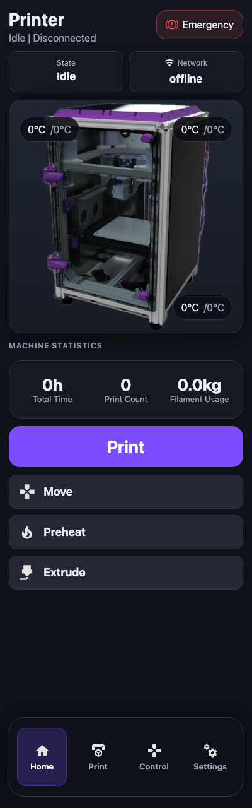
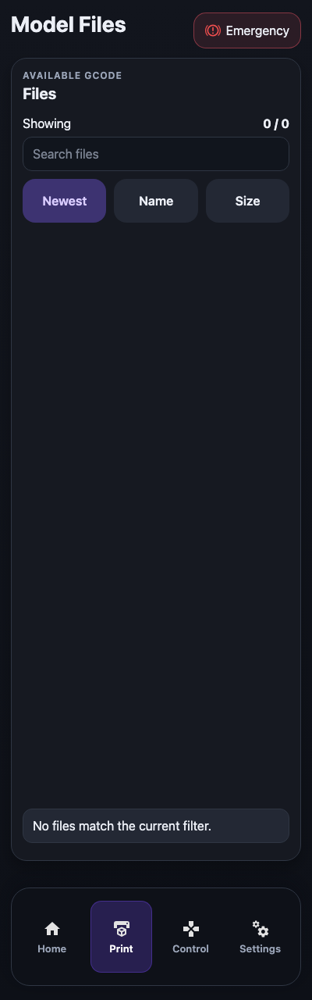
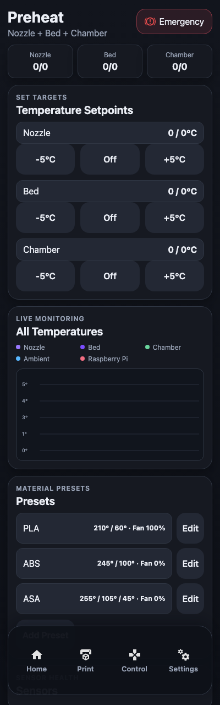
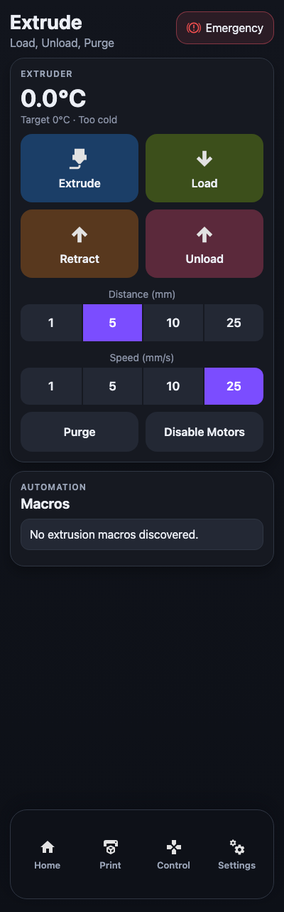
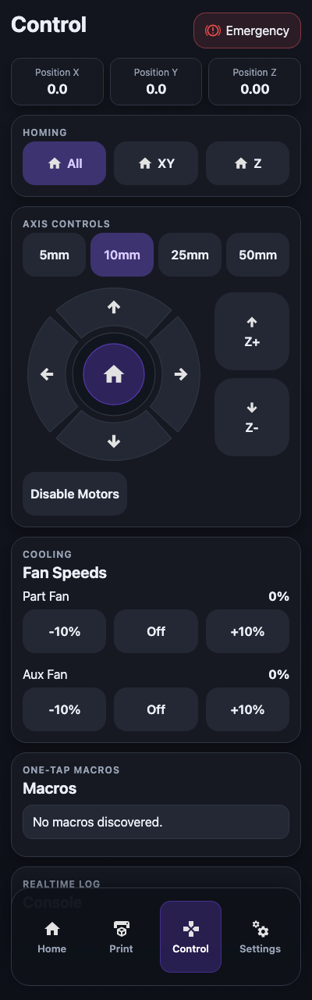
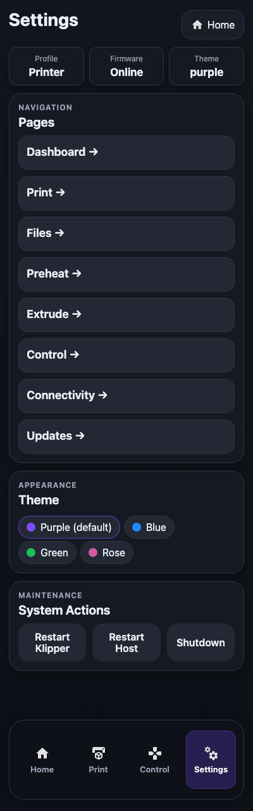
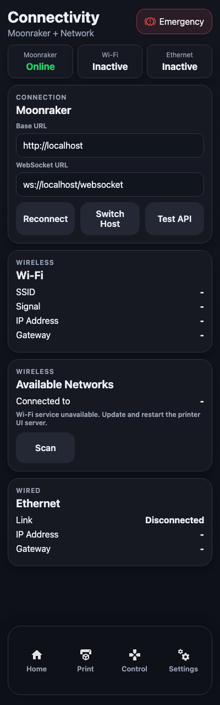
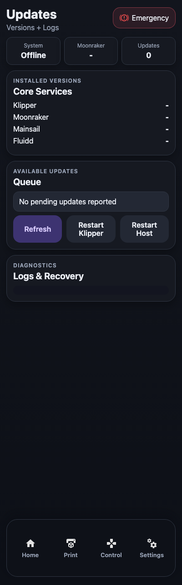
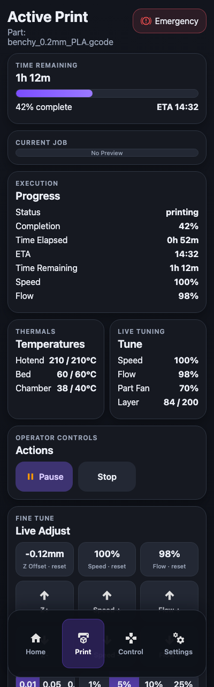

# Klipper Modern UI
This project started because I didn't like the look of KlipperScreen, and since I'm running a somewhat nonstandard VERRRRYYY tall 7.9" screen on one of my printers, the other user interfaces just didn't look right. 
Originally it was designed with the express purpose of being for portrait layout, but with some css trickery I have managed to make it look not bad in landscape as well. 
This is still very much a work in progress. 

Plz support me I dont want to maintain this. 
https://buymeacoffee.com/tiger3dprinting

## Screenshots
Captured at the native `400x1280` portrait size (no printer connected, so values are empty).

| Home | Files | Preheat | Extrude |
|---|---|---|---|
|  |  |  |  |

| Control | Settings | Connectivity | Updates |
|---|---|---|---|
|  |  |  |  |

Print screen (shown while Klipper is printing or paused; this capture uses sample data):




## Main Installation (Recommended)
Run on your printer host user (non-root, must have `sudo`):

```bash
git clone https://github.com/tdunl410/printer-ui-klipper.git printer_ui
cd printer_ui
chmod +x scripts/install-printer-ui.sh scripts/update-printer-ui.sh scripts/uninstall-printer-ui.sh
INSTALL_NODE_METHOD=binary ./scripts/install-printer-ui.sh
```

This installs:
- `/opt/printer-ui/dist` static frontend files
- `/opt/printer-ui/server/static-server.mjs` runtime server
- `/opt/printer-ui/server/kiosk-launch.sh` kiosk launcher (source: `server/kiosk-launch.sh`)
- display tools used by the launcher: `xdotool`, `x11-utils`, `x11-xserver-utils`
- `/etc/default/printer-ui` runtime environment
- `printer-ui.service` systemd service (enabled + started)
- `printer-ui-kiosk.service` systemd service (available for WPE WebKit + Cog kiosk mode)

Defaults:
- Host/port: `127.0.0.1:4409`
- Override before install with: `PRINTER_UI_HOST`, `PRINTER_UI_PORT`

Enable kiosk mode:

```bash
sudo systemctl enable --now printer-ui-kiosk.service
```

The kiosk launcher always sizes the Cog window to the exact X screen resolution
(for example `400x1280`). It runs without a window manager, so it detects the size with
`xdpyinfo`/`xrandr` and keeps the window pinned to it with `xdotool`. To force a size, set
`PRINTER_UI_WINDOW_SIZE=400,1280` in `/etc/default/printer-ui`.

## Update After Changes
```bash
cd ~/printer_ui
./scripts/update-printer-ui.sh
sudo systemctl restart printer-ui.service
sudo systemctl restart printer-ui-kiosk.service
```

## Moonraker Update Manager
Add this to `moonraker.conf` to let Moonraker manage updates for printer-ui:

```ini
[update_manager]
channel: dev

[update_manager printer-ui]
type: git_repo
channel: dev
path: /home/pi/printer_ui
origin: https://github.com/tdunl410/printer-ui-klipper.git
primary_branch: main
managed_services:
  printer-ui
```

Then restart Moonraker and confirm the entry appears in update status:

```bash
sudo systemctl restart moonraker
curl -s http://127.0.0.1:7125/machine/update/status | jq
```

Notes:
- Set `path` to your real git clone location (not `/opt/printer-ui`).
- If you use a fork, change `origin` to your repository URL.

## Uninstall
Run from your repo as your regular printer user (non-root, with `sudo`):

```bash
cd ~/printer_ui
./scripts/uninstall-printer-ui.sh
```

This removes:
- `/opt/printer-ui`
- `/etc/default/printer-ui`
- `/etc/systemd/system/printer-ui.service`
- `/etc/systemd/system/printer-ui-kiosk.service`
- your cloned `printer_ui` repo directory

It also stops/disables the `printer-ui.service` and `printer-ui-kiosk.service` units if present,
then reloads systemd.

It does **not** remove Node.js, Cog/WPE WebKit, or display tools.

## Troubleshooting / Known Issues
- Node install issues: [docs/issues/node-install.md](docs/issues/node-install.md)
- Cog/WPE install issues: [docs/issues/cog-install.md](docs/issues/cog-install.md)
- UI only fills part of the screen: see [docs/issues/kiosk-window-size.md](docs/issues/kiosk-window-size.md)
- Kiosk restarts or screen blinking: [docs/issues/kiosk-restarts-or-blinking.md](docs/issues/kiosk-restarts-or-blinking.md)
- Update button/source path issues: [docs/issues/update-source-path.md](docs/issues/update-source-path.md)
- `npm ci` lockfile drift issues: [docs/issues/npm-lockfile-drift.md](docs/issues/npm-lockfile-drift.md)
- Disabling KlipperScreen service: [docs/issues/disable-klipperscreen.md](docs/issues/disable-klipperscreen.md)

## Local Development
```bash
npm install
npm run dev
```

## Build
```bash
npm run build
npm run preview
```
