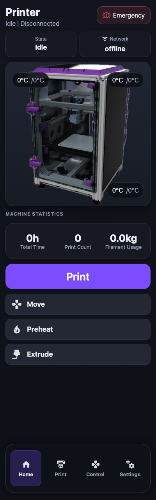
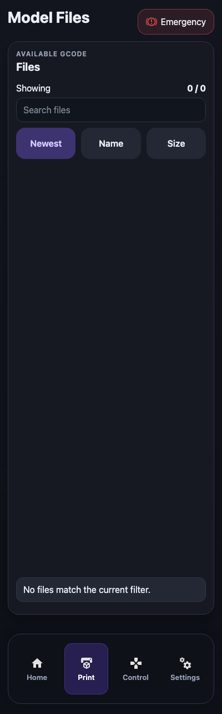
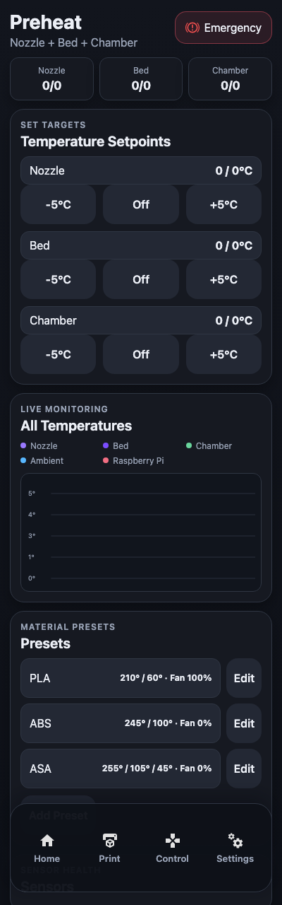
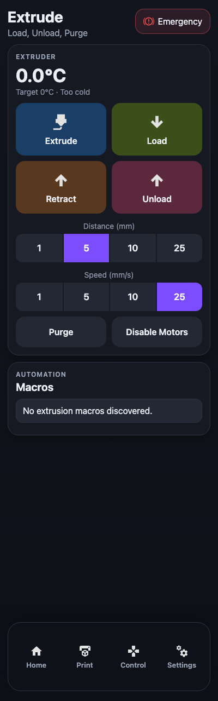
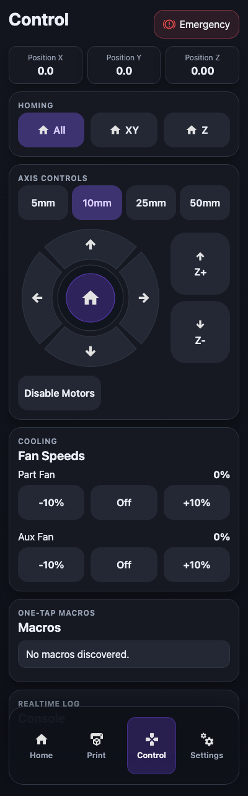
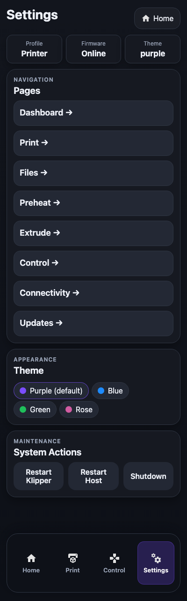
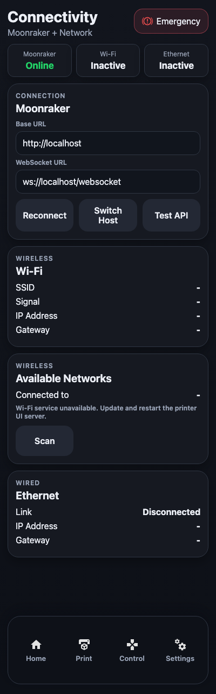
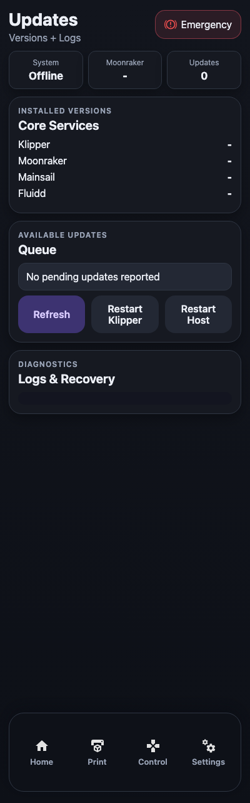
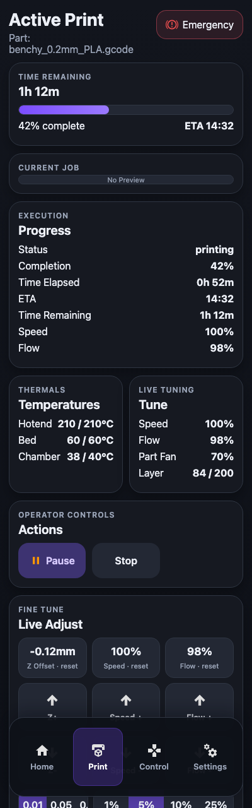

# Klipper Portrait Touch UI
Klipper ui designed for my annex k3 with a vertical waveshare 7.9" touchscreen


## Screenshots
Captured at the native `400x1280` portrait size (no printer connected, so values are empty).

| Home | Files | Preheat | Extrude |
|---|---|---|---|
|  |  |  |  |

| Control | Settings | Connectivity | Updates |
|---|---|---|---|
|  |  |  |  |

Print screen (shown while Klipper is printing or paused; this capture uses sample data):



## Repository Layout
- `src/transport` Moonraker HTTP and WebSocket clients
- `src/services` command methods wrapping mutating actions
- `src/stores` Zustand live state/store
- `src/screens` routed UI screens
- `src/components` shared frame/layout and feedback UI
- `server/static-server.mjs` production static file server for kiosk deployment
- `scripts/install-printer-ui.sh` install/build/systemd setup
- `scripts/update-printer-ui.sh` update path after `git pull`

## Local Development
```bash
npm install
npm run dev
```

## Build
```bash
npm run build
npm run preview
```

## Full Printer Installation (Clone-and-Install)
Run on your printer host user (non-root, must have `sudo`):

```bash
git clone https://github.com/tdunl410/printer-ui-klipper.git printer_ui
cd printer_ui
chmod +x scripts/install-printer-ui.sh scripts/update-printer-ui.sh
./scripts/install-printer-ui.sh
```

The installer now auto-installs/upgrades Node.js 20+ on Raspberry Pi OS/Debian (apt-based) when needed.
Default method uses official Node.js 20 binary install first (avoids apt mirror/package drift issues), then falls back to apt.

Recommended on Raspberry Pi:
```bash
INSTALL_NODE_METHOD=binary ./scripts/install-printer-ui.sh
```

This installs:
- `/opt/printer-ui/dist` static frontend files
- `/opt/printer-ui/server/static-server.mjs` runtime server
- `/etc/default/printer-ui` server runtime environment
- `printer-ui.service` systemd service (enabled + started)
- `printer-ui-kiosk.service` systemd template for Chromium kiosk

Service URLs:
- Default host/port: `127.0.0.1:4409`
- Configure via env vars before install: `PRINTER_UI_HOST`, `PRINTER_UI_PORT`

If you want to disable automatic Node installation:
```bash
AUTO_INSTALL_NODE=0 ./scripts/install-printer-ui.sh
```

Force apt-based Node installation (if you prefer package manager flow):
```bash
INSTALL_NODE_METHOD=apt ./scripts/install-printer-ui.sh
```

Manual Node fallback (if your image blocks auto-install):
```bash
curl -fsSL https://deb.nodesource.com/setup_20.x | sudo -E bash -
sudo apt-get install -y nodejs
```

Enable kiosk mode:
```bash
sudo systemctl enable --now printer-ui-kiosk.service
```

If kiosk restarts or the panel blinks/clears, check:
```bash
systemctl status printer-ui-kiosk.service --no-pager
journalctl -u printer-ui-kiosk.service -n 120 --no-pager
tail -n 120 /tmp/printer-ui-kiosk.log
```

## Update After Changes
```bash
cd ~/printer_ui/printer-ui-klipper
./scripts/update-printer-ui.sh
sudo systemctl restart printer-ui.service
sudo systemctl restart printer-ui-kiosk.service
```

### Lockfile note (`npm ci`)
- Do not delete `package-lock.json`.
- If `npm ci` reports lockfile drift, run:

```bash
npm install
git add package-lock.json
git commit -m "chore: refresh lockfile"
git push
```

The update script now auto-falls back to `npm install` when `npm ci` fails or `package-lock.json` is missing.


## Disabling klipperscreen
```
sudo systemctl disable --now KlipperScreen.service
```


## Does chromium not want to install???


Run these commands exactly on the Pi (copy/paste block by block):
```
sudo rm -f /etc/apt/preferences.d/99-block-bullseye-security
sudo tee /etc/apt/preferences.d/99-block-bullseye-security >/dev/null <<'EOF'
Package: *
Pin: release n=bullseye-security
Pin-Priority: -1
EOF
```
```sudo apt-get clean
sudo rm -rf /var/lib/apt/lists/*
sudo apt-get -o Acquire::ForceIPv4=true -o Acquire::Retries=5 update
```
Then install kiosk deps again:
```
sudo apt-get -o Acquire::ForceIPv4=true -o Acquire::Retries=5 install -y --no-install-recommends xinit xserver-xorg chromium-browser
```
If that still fails, use Debian chromium path:
```
sudo apt-get -o Acquire::ForceIPv4=true -o Acquire::Retries=5 install -y --no-install-recommends xinit xserver-xorg chromium chromium-sandbox
```

Then finish:
```
INSTALL_NODE_METHOD=binary ./scripts/install-printer-ui.sh
sudo systemctl restart printer-ui-kiosk.service
systemctl status printer-ui-kiosk.service --no-pager
```

After it works, re-enable security repo priority by removing the temp pin:
```sudo rm -f /etc/apt/preferences.d/99-block-bullseye-security
sudo apt-get update
```